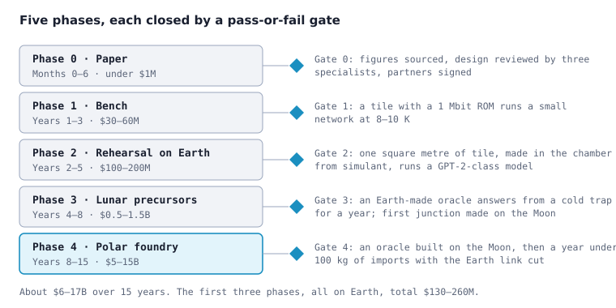

# Shadow Foundry: Technical Brief

Carl Quillen, with Claude (Anthropic) · working paper · 31 October 2026, revised 11 November 2026

An order-of-magnitude design study: what it would take to run a frontier-scale AI model on deliberately simple hardware, first on Earth with 1990s chip processes, then in a permanently shadowed crater at the lunar south pole on superconducting electronics made without photoresist, and ultimately from local rock. Nothing here has been built.

Concept page: <https://claude.ai/artifact/7VSHW81KFbXrb4tn4H8KyR> · Contact: [@shadowllm](https://x.com/shadowllm)

Archived PDF: [doi:10.5281/zenodo.24140130](https://doi.org/10.5281/zenodo.24140130)

Revised November 11, 2026. This revision corrects the sizing of the Earth machine, replaces the magnetic memory with laser-programmed ROM tiles, adds a reference design for the crater machine with its heat budget, re-stages the program as a ladder of oracles, re-costs it, and checks the public figures against sources. The corrections are listed at the end.

## Abstract

Shadow Foundry is an order-of-magnitude design study of how simple the hardware can be and still run a frontier-scale AI model, if speed is given up. The working case is a 2-trillion-parameter mixture-of-experts model with 200 billion parameters active per token, stored at 4 bits per weight (1.2 TB with error correction). The study finds that storage, not computation, sets the technology floor.

Two machines are worked through. The first is an Earth machine built on 350 or 180 nm chip processes, with weights held in read-only or one-time-programmable memory. It runs about 20 tokens per second on 10–30 kW. The second is a machine in a permanently shadowed crater at a lunar pole, using niobium-nitride superconducting logic at 8–10 K, patterned without photoresist by stencil or laser scribing, with weights stored as laser-programmed inductive links on about 14,000 m² of tile. It produces one token every 10 seconds per stream, across about 100 streams, on roughly 0.5 kW. The crater machine is not the efficient choice: silicon made on Earth and landed on the Moon would give more tokens per watt and per kilogram. Its case is that it could be made there, from local materials.

The brief derives every figure in the open and tags each with its basis and uncertainty. It closes with a five-phase, gated research program of about $6–17B over 15 years, of which the first three phases, all on Earth, total $130–260M. Progress toward self-sufficiency is measured by the mass imported from Earth per year. Nothing described here has been built, and no specialist has yet reviewed the work.

**摘要**

“影子铸造厂”（Shadow Foundry）是一项以数量级为尺度的设计研究，要回答的是：若不再追求速度，运行前沿级大模型的硬件究竟能简单到什么地步。研究对象是一个两万亿参数的混合专家模型，每个词元激活约两千亿参数，权重以4比特精度存储（算上纠错开销共1.2 TB）。研究发现，决定技术下限的是存储，而不是计算。

文中推演了两种机器方案。第一台建在地球上，采用350或180纳米制程，权重存放在掩膜只读存储器或一次性可编程存储器中，功耗10至30千瓦，每秒约20个词元。第二台位于月球极区永久阴影区的撞击坑内，采用在8至10 K下工作的氮化铌超导逻辑，图形经镂空掩膜成形，或由激光刻划成形，全程不用光刻胶；权重以激光熔断编程的电感连接形式，存于约1.4万平方米的基板上。在约100路并发会话下，每路每10秒生成一个词元，整机功耗约500瓦。这台机器并不高效：把地球上制造的硅芯片运上月球，每瓦、每千克能产出的词元都更多；它的意义在于可以用月球本地材料就地制造。

文中每个数字都给出推导，并注明依据与不确定度。文末给出一份分五个阶段、逐阶段设关口的研究计划，15年内约需60亿至170亿美元；其中前三个阶段全部在地球上完成，合计1.3亿至2.6亿美元。自给程度以每年仍需从地球运入的质量来衡量。上述一切均尚未建成，也未经相关领域专家评审。

本文由 Carl Quillen 与 Anthropic 的人工智能模型 Claude 共同撰写。Carl Quillen 主持并审阅了这项工作，并对内容负责。

## How to read this

This is the napkin behind the Shadow Foundry page: every figure there is derived here, in the open, so that someone serious can check it, replace an assumption, and see what moves. Nothing in it has been built or measured by us. Every number is an order-of-magnitude estimate. Published figures that could be checked were checked for this revision; they are linked where they are used or listed at the end. Treat each number as good to a factor of three unless a tighter range is stated.

Conventions:

- Operations are 4-bit multiply-accumulates unless stated. One multiply-accumulate is counted as two floating-point operations when comparing with published FLOPS.
- Bytes are decimal: 1 TB = 10<sup>12</sup> bytes.
- "The model" throughout is a hypothetical 2-trillion-parameter mixture-of-experts network with about 200 billion parameters active per token. It stands in for any frontier-class model of that shape.
- Where a number comes from a published figure (a process density, a crater temperature, a scanner price), it is marked *public*. In the appendix, sourced means the page was opened and read for this revision, and recalled means it was not. Where it is our own estimate it is marked *est.*

The argument runs in three parts. Sections 1 to 5 size an Earth-side machine on 1980s and 1990s process technology. Sections 6 to 10 move the design to the lunar pole, cold and slow, and end with a reference design for the crater machine. Sections 11 to 14 are the program: the experiment, the money, the risks, and what carries over to the asteroid belt.

**Authorship and AI use.** This brief was written with Claude, Anthropic's AI model, over a series of conversations in October and November 2026. Carl Quillen posed the questions, set the direction and reviewed the results. Claude proposed much of the design, did the arithmetic, drafted the text and figures, and ran the source checks, some of them through automated research agents. A conversation with Google's Gemini prompted the corrections to the cooling design. A critique by Alibaba's Qwen prompted the comparison with landed silicon and the other changes of the third pass listed at the end, and Qwen also reviewed the Chinese abstract. No human specialist has yet reviewed the work; that review is Phase 0 of the program. Carl Quillen takes responsibility for the published content.

## 1. The model being hosted

The machine has to hold about 1.2 terabytes of weights (2 trillion parameters at 4 bits each, plus error correction) and perform about 4×10<sup>11</sup> operations per token. Everything else follows from those two numbers.

**Parameters.** A 2T-parameter mixture-of-experts model with 200B parameters active per token (the shape of several current frontier models) is the working assumption. Where a derivation needs them, it has about 100 layers and a hidden size of about 8,000. A dense 2T model would need ten times the operations per token but the same storage; the storage figures below apply to both.

**Operations per token.** Each active parameter is used in one multiply-accumulate per token in the forward pass:

```math
N_{ops} \approx N_{active} = 2 \times 10^{11} \text{ MAC/token} \approx 4 \times 10^{11} \text{ FLOP/token}
```

Attention adds about two operations per context position, per hidden element, per layer. That is roughly 10<sup>10</sup> at an 8,000-token context, under a tenth of the feed-forward term, and about 2×10<sup>11</sup> at 128,000 tokens, where it matches it. Those operations run against the context cache, which is read-write memory: about 13 GB per conversation at 8,000 tokens with 8-bit keys and values. That is an upper figure: it assumes full-width keys and values in every layer. Current models share keys and values across groups of attention heads, which with 4-bit storage cuts the cache 8 to 16 times, to about 1 GB. Sections 3 and 9 treat that cache separately from the read-only weights, because it is the hard part.

**Storage.** Quantized to 4 bits per weight plus error-correction overhead:

```math
S = 2 \times 10^{12} \times 4 \text{ bit} = 8 \times 10^{12} \text{ bit} = 1.0 \text{ TB}; \quad S_{ECC} \approx 1.2 \text{ TB at } 20\% \text{ overhead}
```

Ternary weights (about 1.6 bits each) would cut this to 0.4 to 0.5 TB with some quality loss. The brief uses 4-bit throughout as the conservative choice.

**Bytes moved per token.** The active weights must be read once per token at batch size 1:

```math
B_{token} = 2 \times 10^{11} \times 0.5 \text{ byte} = 100 \text{ GB/token}
```

This is the number that drives the whole architecture. At one token per second it is 800 Gbit/s of sustained read bandwidth. Batching across users divides it by the batch size, because the same weight read serves every sequence in the batch. In a mixture-of-experts model that holds only for sequences routed to the same experts, so the gain is smaller than the batch size.

| Quantity | Value | Basis |
| --- | --- | --- |
| Total parameters | 2×10<sup>12</sup> | assumed |
| Active per token | 2×10<sup>11</sup> | assumed, MoE |
| MAC per token | 2×10<sup>11</sup> | one per active weight |
| Storage at 4-bit | 1.0 TB | est. |
| Storage with ECC | 1.2 TB | est., 20% overhead |
| Weight bytes read per token | 100 GB | est. |
| KV cache, 8k context | ~1–13 GB per stream | est., model-dependent |

## 2. Why storage sets the floor, not compute

Slowing the clock makes compute cheap at any technology level, but it does nothing to the 10<sup>13</sup> bits that must be stored and read. The technology floor is therefore set by memory density and read bandwidth, and lithography enters only through memory.

**Compute scales with patience.** A machine delivering R operations per second produces one token every N\_ops / R seconds. Historical machines, as a sanity check on the slope:

| Era, machine (public) | Rate | Seconds per token at 4×10<sup>11</sup> FLOP |
| --- | --- | --- |
| 1997, ASCI Red | ~1 TFLOPS | 0.4 |
| 1985, Cray-2 | ~2 GFLOPS | 200 (3 min) |
| 1964, CDC 6600 | ~3 MFLOPS | 1.3×10<sup>5</sup> (1.5 days) |
| 1954, IBM 704 | ~40 kFLOPS | 10<sup>7</sup> (4 months) |

The mapping from these floating-point rates to 4-bit integer MACs is loose by a factor of a few, but the slope is the point: any post-1950 technology can run the model if you accept the token rate.

**Storage does not scale with patience.** The same 10<sup>13</sup> bits are needed whatever the speed. Capacity per unit of the dominant medium of each era gives the installation size:

```math
N_{units} = \frac{S_{ECC}}{C_{unit}} = \frac{1.2 \times 10^{12} \text{ B}}{C_{unit}}
```

| Medium (public) | Capacity per unit | Units for 1.2 TB |
| --- | --- | --- |
| 1956 RAMAC disk | 5 MB | 240,000 |
| 1980s–90s disk | 1 GB | 1,200 |
| 350 nm DRAM wafer, 200 mm | ~1 GB | ~1,200 |
| 350 nm mask ROM wafer, 200 mm | ~2–4 GB | 300–600 |
| LTO-class tape cartridge | 10+ TB | 1 |

So a building-sized installation needs 1980s-or-later storage density, whatever the logic is made of. The 350 nm era is the first in which the weights fit in a few hundred wafers of silicon, and that is why the reference machine in section 3 starts there.

**Bandwidth is the second constraint.** Even with the capacity in hand, 100 GB per token must be read. A single tape or disk head reads at 10<sup>8</sup> to 10<sup>9</sup> bit/s, so at batch size 1 a single stream would take 10<sup>3</sup> to 10<sup>4</sup> seconds per token. Two things fix this. Batching divides the per-token read by up to the batch size, and by less for a mixture-of-experts model (section 1). Parallelism across many small memories with their own sense amplifiers multiplies the read rate, which is why the architecture moves activations to the weights rather than the reverse. That is section 3.

## 3. Earth-side reference machine

A ROM-tile inference machine at 350 nm is about 34,000 dies, 11 racks and a few tonnes. It serves one conversation at about 20 tokens per second, or about a hundred at once at that speed, and draws 10 to 30 kW. At 180 nm it is roughly a quarter of the hardware. These numbers size the Earth-side continuity machine. The crater machine in sections 9 and 10 reuses the architecture, not the figures.

**Principle.** Each die holds a slice of the weights in read-only memory beside a small bank of multiply-accumulate units. The activation vector is broadcast to the dies that hold the selected experts; each die reads its own weights through a wide internal bus and returns a partial sum. Only activations cross die boundaries.

**Memory density.** Mask ROM cells have been built at about 3.4 to 9 F², where F is the feature size ([ROM technology notes](https://web.eecs.umich.edu/~prabal/teaching/eecs373-f10/readings/rom-eprom-eeprom-technology.pdf)). Take 5 F² at 350 nm:

```math
A_{cell} \approx 5 F^2 = 5 \times (0.35\ \mu m)^2 \approx 0.6\ \mu m^2 \;\Rightarrow\; 1.6 \times 10^{8} \text{ bit/cm}^2 \text{ (cells)}
```

Sense amplifiers, decoders, ECC and the MAC units take about half the die, so the usable density is about 8×10<sup>7</sup> bit/cm², or 10 MB/cm². The same arithmetic at 180 nm gives roughly 3.8× the density, about 35 MB/cm².

**Silicon area and die count.**

```math
A_{total} = \frac{1.2 \times 10^{12} \text{ B}}{10^{7} \text{ B/cm}^2} = 1.2 \times 10^{5} \text{ cm}^2 = 12\ \text{m}^2 \text{ at 350 nm}; \quad \approx 3.5\ \text{m}^2 \text{ at 180 nm}
```

A 4 cm² die holds about 35 MB once scribe lanes and pads are taken out, so the machine is about 34,000 dies at 350 nm and about 9,000 at 180 nm. A 200 mm wafer gives about 60 good dies of that size at 80% yield, so around 600 wafers and 150 wafers respectively.

**Layers run in sequence.** A forward pass visits the layers one after another, so for a single conversation only the dies of the current layer are working. With 100 layers, each layer has 2×10<sup>9</sup> active weights, held on about 33 dies of 6×10<sup>7</sup> weights each. For 20 tokens per second each layer gets 0.5 ms:

```math
R_{die} = \frac{6 \times 10^{7} \text{ MAC}}{0.5 \text{ ms}} = 1.2 \times 10^{11} \text{ MAC/s per die} \;\Rightarrow\; 1{,}200 \text{ MAC units at 100 MHz}
```

Each unit computes one output row. The activation vector is broadcast one element per clock, and every unit multiplies it by the next weight from its own ROM row. A 4-bit by 8-bit multiplier with a 24-bit accumulator is about 550 gates, or 0.03 mm² at 350 nm, so 1,200 units take about 37 mm², under a tenth of the 4 cm² die. Averaging the work over every die, as the first version of this brief did, gives a dozen units per die and a single stream at 0.2 tokens per second.

**Bandwidth.** Each active die reads its 30 MB in 0.5 ms, which is 60 GB/s: about 4,800 bit lines sensed in parallel at 100 MHz, one 4-bit weight per unit per clock. ROM arrays read many columns at once by construction, so this is a layout requirement, and no line runs faster than 100 MHz.

Activations between dies are small. The hidden state is about 8 KB at 8 bits per element, so a token moves a few MB across the whole machine, which cheap serial links on backplanes handle.

**Many streams.** Different conversations can occupy different layers at the same moment. About 100 streams run interleaved at 20 tokens per second each, or 2,000 tokens per second in aggregate, on the same hardware.

**Power.** Reading a ROM bit at 350 nm costs 1 to 5 pJ with reduced-swing sensing, and a 550-gate MAC about 10 pJ:

```math
E_{token} \approx 8 \times 10^{11} \text{ bit} \times 2 \text{ pJ} + 2 \times 10^{11} \text{ MAC} \times 10 \text{ pJ} \approx 3.6\ \text{J/token}
```

Add a factor of 3 for clock trees, I/O and board losses: about 10 J per token. One stream is 200 W of dynamic power and a hundred streams about 20 kW. Static power is separate: 340 boards with regulators and link drivers draw perhaps 20 to 30 W each, about 10 kW unless idle boards are power-gated. With power gating, idle draw falls to the hundreds of watts.

**Mass and volume.** 34,000 dies at 100 dies per board on 340 boards, 32 boards per rack, is about 11 racks. At 300 to 400 kg per populated rack the machine is 3 to 5 tonnes and occupies 30 to 50 m² with aisles and cooling.

**Context cache.** Each conversation needs 1 to 13 GB of read-write memory at an 8,000-token context. In 350 nm DRAM at about 1 GB per wafer that is between one wafer and a dozen per stream. A hundred full-context streams need 100 to 1,300 wafers of DRAM, against about 600 of ROM. Either contexts are short, or the cache uses denser stockpiled memory than the rest of the machine. It is omitted from the totals above and is the one part that is not read-only.

|  | 350 nm | 180 nm |
| --- | --- | --- |
| Usable memory density | ~10 MB/cm² | ~35 MB/cm² |
| Silicon area | ~12 m² | ~3.5 m² |
| Dies, 4 cm² | ~34,000 | ~9,000 |
| Good wafers, 200 mm | ~600 | ~150 |
| Boards / racks | ~340 / 11 | ~90 / 3 |
| Speed, one stream | ~20 token/s | ~20 token/s |
| Streams at that speed | ~100 | ~100 |
| Dynamic energy per token | ~10 J | ~2 J |
| Power, one stream to full load | 10–30 kW | 3–7 kW |
| Mass | 3–5 t | 1–2 t |

All figures *est.*; the density figures rest on a 5F² cell, which is the one assumption a process engineer should check first.

## 4. Archival and duplication

The weights are preserved on optical or film media that need only a camera to read, and are restored into silicon through a programmer. The two tiers exist because no optical medium delivers the 100 GB-per-token read bandwidth, and no silicon medium lasts a millennium.

**Capacity per copy.** Densities of candidate media, with the number of pieces needed for 1.2 TB:

| Medium | Density (public, approx.) | Pieces for 1.2 TB | Write | Copy |
| --- | --- | --- | --- | --- |
| Pressed CD-class disc | ~10<sup>8</sup> bit/cm² | ~1,700 | stamper | injection molding, seconds each |
| Blu-ray-class disc | ~2×10<sup>9</sup> bit/cm² | ~50 | laser | molding or laser |
| Silver-halide film or glass plate | ~10<sup>8</sup>–10<sup>9</sup> bit/cm² | ~100–1,000 | laser or e-beam | contact print, whole plate at once |
| Femtosecond-written glass (Silica-class) | ~3×10<sup>11</sup> bit/cm² (volumetric, ~5 TB per 120 mm tile) | 1–2 | fs laser, days per TB per beam | re-write only |

**Write time for the glass master.** A femtosecond writer at a few tens of Mbit/s per beam:

```math
t_{write} = \frac{9.6 \times 10^{12} \text{ bit}}{3 \times 10^{7} \text{ bit/s}} \approx 3 \times 10^{5} \text{ s} \approx 4 \text{ days per beam}
```

Ten beams or ten writers make a copy in under a day. Reading is a microscope, an LED, polarizers and a 1990s-class camera sensor; the decoder runs on anything.

**Restoring into silicon.** Two routes, and the plan uses both:

- *Mask ROM.* A 22×22 mm reticle field at 10 MB/cm² holds about 48 MB, so 1.2 TB needs about 25,000 distinct programming-layer reticles at 350 nm, or about 7,000 at 180 nm. At a few thousand dollars each that is tens of millions of dollars in masks, reused for every copy. It makes sense for a small number of long-lived gold copies and nothing else.
- *Electrically programmed NOR flash or one-time-programmable cells.* Loaded from the optical master by a programmer at a few MB/s per channel: 1.2 TB on 100 channels is about an hour. Retention is 10 to 20 years rather than indefinite. This is the route for working copies and for any revised model.

The pipeline is: glass or film master, in several copies at separate sites; a camera-and-decoder reader buildable from late-1990s parts; a programmer that writes flash or OTP wafers from stockpiled blanks; and, for the one gold machine, a mask ROM set. The archival layer only has to be readable by something that can be rebuilt from a printed description.

## 5. Fab economics

The cheapest resilient option on Earth is to buy and stockpile the silicon from trailing-edge foundries now, and keep a minimal 1 µm line only for replacements. Building the chips costs single-digit millions; keeping the ability to build them costs tens of millions plus a running payroll.

| Tier | Node, wafer | Output | Capital (public, approx.) |
| --- | --- | --- | --- |
| Leading-edge EUV fab | 2–5 nm, 300 mm | 30–100k wafers/month | $20–40B+ (one EUV scanner $200–400M) |
| Mature volume fab | 14–28 nm, 300 mm | 40–60k wafers/month | $3–8B |
| Trailing-edge volume fab | 90–180 nm, 200 mm | 30–50k wafers/month | $1–2B new, far less used |
| Small trailing-edge line | 180–350 nm, 150–200 mm | 3–10k wafers/month | $50–300M, refurbished tools |
| Minimal pilot line | 0.35–1 µm, 100–150 mm | 100–1,000 wafers/month | $10–50M |

**Why cost falls so steeply down the table.** Used i-line steppers cost under a million to a few million dollars against hundreds of millions for EUV. Cleanroom class drops from 1 to 1000. Process steps drop from over a thousand to under a hundred, so tool count and staff drop with them. Pre-2000 150 mm and 200 mm tools are cheap on the secondary market, though spares and service are thinning.

**What the build actually needs.** The working machine uses electrically programmed cells, not mask ROM, so one mask set serves every die and the weights are loaded afterwards (section 4). Those cells are about twice the size of mask ROM cells, which doubles the wafer, board and rack counts of section 3: about 1,200 wafers at 350 nm or 300 at 180 nm, once, plus spares. At $1,000 to $2,000 per wafer in volume and $50,000 to $300,000 per mask set:

```math
C_{silicon} \approx 1{,}200 \times \$1{,}500 + \$200{,}000 \approx \$2\text{M}; \quad \text{with packaging, boards, racks, power: } \$4\text{–}12\text{M}
```

A mask-ROM gold copy is denser and lasts longer, and adds its own reticle set: tens of millions of dollars (section 4).

**Stockpile versus captive line.** A foundry purchase is cheap but assumes the industry survives. A minimal captive line at about 1 µm costs $10 to $50M in equipment and $5 to $20M a year to run (staff, gases, chemicals, power), and takes a year or more of yield learning before it produces usable parts. Over a decade the running cost exceeds the equipment. The hybrid is to stockpile finished dies and blank wafers now, maintain the small line for replacements only, and keep the process recipes, the inference design files and the weights in printed and microfilm form beside it.

**Cost per token, for curiosity.** At $0.10/kWh, a single stream on the 10 kW 350 nm machine costs 500 J per token, about $14 per million tokens. Fully loaded, with 100 streams and about 30 kW, it is 15 J per token, about $0.40 per million. Capital dominates at low use: a $5M machine amortized over 10 years is $1,400 a day, which is about $1.40 per thousand tokens at 10<sup>6</sup> tokens a day and about $8 per million at full load.

## 6. Cold and slow: superconducting logic

Once the design may run cold and slow, Josephson-junction logic replaces CMOS. The energy dissipated per token at the cold stage drops from joules to about two millijoules, the process needs 1980s feature sizes and a handful of layers, and the Moon's cold traps supply most of the cooling. The last lift, from 40 K to 8 K, is cheap because the machine packs into a block with little surface (section 10).

**Energy per operation.** A single-flux-quantum switching event dissipates roughly the product of the flux quantum and the junction critical current:

```math
E_{sw} \approx \Phi_0 I_c = 2.07 \times 10^{-15} \text{ Wb} \times 100\ \mu\text{A} \approx 2 \times 10^{-19} \text{ J}
```

Conventional RSFQ logic is ruled out at once. Its bias resistors dissipate about 800 nW per gate whether or not the gate is clocked, roughly 60 times its switching power even at 20 GHz ([Mukhanov](https://snf.ieeecsc.org/files/ieeecsc/slides/ST242.pdf)), and a slow machine pays that all the time. Two families avoid it. ERSFQ removes most of the static term and spends about one switching energy per junction per clock. Adiabatic quantum-flux-parametron (AQFP) logic has been measured at 1.4 zJ per junction at 5 GHz, falling in proportion to clock frequency ([Takeuchi](https://snf.ieeecsc.org/files/ieeecsc/2023-04/Takeuchi_Abstract%20ISS%202021.pdf)). Some gate transitions are not adiabatic and leave a residue of order 10<sup>-20</sup> J per gate operation however slow the clock ([Yamae et al.](https://arxiv.org/abs/1907.03962)). Take that residue as the cost of a slow AQFP gate. A bit-serial multiply-accumulate is about 300 gates and takes 16 clock cycles:

```math
E_{MAC} \approx 300 \times 16 \times 10^{-20}\ \text{J} \approx 5 \times 10^{-17}\ \text{J}; \quad E_{token} \approx 2 \times 10^{11} \times 5 \times 10^{-17}\ \text{J} \approx 10\ \mu\text{J}
```

The same unit in ERSFQ, at about 600 junctions, costs about 2×10<sup>-15</sup> J and 0.4 mJ per token. The baseline is AQFP for three reasons: energy, tolerance of wide critical-current spread, and AC power delivered through series excitation lines, which keeps the current crossing into the cold stage small.

Compute is not the whole cold-stage bill. Reading the weights costs more: about 2×10<sup>-15</sup> J per bit in word-line drive, or about 2 mJ per token (section 9). Either way one stream dissipates well under a milliwatt, and the cooler's load is set by heat leaking in, not by the electronics (section 10).

**Cooling cost.** Heat lifted from the logic has to leave through a radiator warmer than the 40 K surroundings; take 60 K. The ideal work per watt lifted is the Carnot ratio:

```math
\frac{W}{Q} \ge \frac{T_{radiator} - T_{logic}}{T_{logic}} = \frac{60 - 8}{8} = 6.5
```

Small cryocoolers reach only 2 to 5% of that ideal near 10 K, and 1 to 2% near 4 K ([ter Brake and Wiegerinck](https://ris.utwente.nl/ws/files/6849622/Brake02low.pdf); [NIST review](https://trc.nist.gov/cryogenics/Papers/Review/2020-Review_of_Refrigeration_Methods.pdf)). A flight example: Planck's hydrogen sorption cooler lifted 1.1 W at 17 K for 301 W of input ([Planck collaboration](https://arxiv.org/abs/1101.2023)). The alternative with no moving parts is a radiator at the logic temperature itself, viewing only deep space, which needs an area of 1/(εσT⁴) per watt:

| Logic | Runs at | Ideal work per watt lifted | Realistic small cooler | Passive radiator per watt |
| --- | --- | --- | --- | --- |
| Nb | 4.5 K | 12 | 600–1,200 W/W | ~48,000 m² |
| NbN | 8 K | 6.5 | 130–330 W/W | ~4,800 m² |
| MgB₂ | 20 K | 2 | 40–100 W/W | ~120 m² |

The radiator areas assume a plate that sees nothing but deep sky. Inside a 40 K cold trap or vault, a plate colder than 40 K gains heat from its surroundings. A passive stage below the local temperature therefore needs a shielded view of the sky from the surface, and its shields and supports bring heat leaks that this brief has not budgeted. The passive figures are bounds, not designs.

**Operating temperatures and materials.** Candidate superconductors and their critical temperatures (public):

| Material | T\_c | Operates comfortably below | Lunar availability |
| --- | --- | --- | --- |
| Al | 1.2 K | 0.3 K | abundant, but T\_c too low |
| Nb | 9.3 K | 4–5 K | trace; import |
| NbN | ~16 K | 8–10 K | Nb import, N from import or polar ice |
| NbTiN | ~15 K | 8–10 K | Ti abundant, Nb import |
| MgB₂ | 39 K | 20–25 K | Mg abundant, B trace; import grams |

The cold traps run 25 to 40 K (section 8). Only MgB₂ superconducts comfortably there, and it is far less mature: the largest MgB₂ circuit we found is a six-junction flip-flop, working to 65 GHz at 20 K ([Cunnane et al.](https://snf.ieeecsc.org/files/ieeecsc/2023-06/STH10_HP64_Cunnane.pdf)). Growing MgB₂ also needs hot magnesium vapour and boron, which does not fit a simple deposition step. The baseline is therefore NbN at 8 to 10 K. An NbN circuit of 105 junctions has run at up to 9.8 K ([Terai and Wang](https://acnpsearch.tweb-dev.unibo.it/singlejournalindex/85049305)). NbN films sputtered at room temperature reach 14.6 K at 124 nm thickness on oxidised silicon and sapphire ([Glowacka et al.](https://arxiv.org/abs/1401.2276)), so the operating point has margin if the same holds on lunar glass. And 8 to 10 K is about the lowest temperature a simple lead regenerator reaches; colder stages need rare-earth regenerator materials ([NIST review](https://trc.nist.gov/cryogenics/Papers/Review/2020-Review_of_Refrigeration_Methods.pdf)). Niobium at 4.5 K is the fallback if NbN junctions disappoint. It is the most mature junction technology there is, at four to five times the cooler power per watt lifted. MgB₂ is the long-term goal, because at 20 K a passive radiator of about a hundred square metres per watt replaces the cooler altogether.

The price of NbN is nitrogen. The films are deposited in a low nitrogen pressure and the AlN barrier is grown in nitrogen, which open vacuum cannot hold. Deposition therefore happens under a small hood fed with nitrogen and open to the sky through its gaps. A hood leaking through 1 cm² at 10<sup>-3</sup> mbar loses about a gram of nitrogen a day (est.), so the supply is a kilogram-scale import, or a by-product of polar ice (section 8).

Niobium is not a gram-scale import at full size. The stack is about 0.75 µm of NbN over half the area, 3 g per square metre. A rung-1 oracle of 14 m² holds about 40 g. The full oracle of 14,000 m² holds about 40 kg, and perhaps three times that leaves the source once overspray is counted (est.).

**Coarse superconducting circuits have been built before.** IBM's Josephson computer project used a 2.5 µm lead-alloy process with latching logic on AC power before it was cancelled in 1983 ([IBM](https://research.ibm.com/publications/ac-powered-josephson-latch-circuits); [Physics Today](https://physicstoday.aip.org/features/between-research-and-development-ibm-and-josephson-computing)). Earlier still, the thin-film cryotron circuits of the 1960s were evaporated in vacuum through metal masks, at line widths of 125 to 500 µm, and run near 3.5 K ([Electronic Design](https://www.electronicdesign.com/archive/rca-computer-memory-uses-superconductivity)). That is the resist-free method this brief proposes, sixty years early. It is also the warning: cryotron arrays of 10<sup>4</sup> to 10<sup>6</sup> components had serious yield problems, and insulator reliability ended the IBM effort ([IEEE CSC history](https://snf.ieeecsc.org/files/ieeecsc/slides/RN28e-1.pdf)). Today's densest process, MIT Lincoln Laboratory's SFQ5ee, has 350 nm features on 200 mm wafers ([Tolpygo et al.](https://arxiv.org/abs/1509.05081)), and the largest circuit reported in it has about 809,000 junctions ([Semenov et al.](https://arxiv.org/abs/1701.03837)). The full oracle needs about 10<sup>11</sup> (section 10).

MIT Lincoln Laboratory is not the only line. The Shanghai Institute of Microsystem and Information Technology has published a niobium process with 0.5 µm junctions at 15 kA/cm², built in 19 mask levels with planarization between layers ([Ying et al.](https://arxiv.org/abs/2304.01588)). That mask count is what a conventional process costs, and it is what the resist-free route of section 7 sets out to avoid.

## 7. Patterning without resist

A Josephson process can be reduced to about eight deposition and barrier-growth steps with no photoresist, developer, wet etch or pump. Two dry ways of patterning fit it: depositing through mechanical stencils, and scribing blanket films with a pulsed laser. Both cost feature size, 5 to 20 µm in place of 1 µm, which costs density and nothing in function at low clock rates. Stencils suit the first rungs of the ladder. At full size the arithmetic favours scribing.

**Flow.** Each step is an evaporation or sputtering, patterned either by a stencil held a few micrometres above the substrate or by a laser scribe afterwards.

1. Substrate: polished regolith-derived glass or silicon, with a thin dielectric.
2. Ground plane: NbN, 200 nm, through a coarse stencil.
3. Dielectric: SiO₂ or Al₂O₃, 100–200 nm, through the inverse stencil, by evaporation of the oxide or by Al deposition plus oxidation.
4. Base electrode: NbN, 150 nm.
5. Barrier: 5–7 nm Al deposited through the same stencil, then exposed to a nitrogen plasma or controlled nitrogen pressure to grow about 1 nm of AlN. This is the critical layer and it is grown, not patterned. (NbN films are made by evaporating or sputtering Nb in a low nitrogen pressure. The Earth-side demonstrator can start with classic Nb/AlOx/Nb at 4 K before moving to NbN.)
6. Counter electrode: NbN, 100 nm, through a stencil that defines the junction area.
7. Dielectric: as step 3.
8. Wiring: NbN, 300 nm, with contact openings defined by the stencil.

Resistors, needed in line drivers and readout stages, are deposited Mo, Ti or a thin Nb-Ti alloy through one more stencil.

**Stencils.** Laser-cut metal foil, or silicon-nitride membranes made on Earth and imported. A stencil with 10 µm openings and 10 µm bars is well inside laser machining tolerance. Three limits matter:

- *Blur.* Features spread by roughly the gap times the angular width of the source. With a 5 µm gap and a small source at 300 mm that is under 1 µm (est.); a published case shows 1.5 µm of edge blur at a 15 to 30 µm gap.
- *Clogging.* The deposit grows on the stencil too, and apertures close by about as much as the thickness deposited ([EPFL](https://infoscience.epfl.ch/record/186750/files/EPFL_TH5715.pdf?version=1)). A 10 µm opening loses a tenth of its width after roughly five 200 nm depositions. On Earth the cure is a wet etch.
- *Overlay.* Eight layers must register to a few micrometres across each stencil field, which puts a precision stage under every deposition head.

**Scribing.** The alternative is to deposit each film as a blanket and remove what is not wanted with a pulsed laser. Thin-film solar modules are patterned this way in production, with scribes 30 to 100 µm wide at more than 2 m/s ([review](https://www.ncbi.nlm.nih.gov/pmc/articles/PMC5233978/)). Here the spot is 5 to 10 µm, finer than that practice. The hard part is selectivity: clearing a 200 nm layer without damaging the one beneath or scattering conductive debris. The same laser cuts the ROM links that hold the weights (section 9).

**Throughput.** Both figures are estimates for one tool:

| Method | Assumption | Finished eight-layer tile | Full oracle, 14,000 m² |
| --- | --- | --- | --- |
| Stencil head | 100 cm² field, 5 minutes per aligned exposure, 5 uses per stencil | ~130 m² a year, ~160 stencils per m² | ~100 head-years, ~2 million stencils |
| Laser scribe | 10 µm spot, 10<sup>6</sup> spots a second, half of each layer removed | ~800 m² a year | ~18 laser-years |

Rung 0 and rung 1 are days to weeks of work by either method. Rung 3 is about twenty laser-years, a few years of work for ten lasers, and impractical with stencils unless they can be cleaned in vacuum.

**Density.** A 10 by 10 µm junction with its shunt and wiring occupies about 50 by 50 µm, so junctions alone could reach 4×10<sup>4</sup> per cm². Logic is far sparser, because AQFP gates are mostly inductor and transformer. In the processes where they were developed a buffer is about 40 by 30 µm and a majority gate 60 by 70 µm ([Xie et al.](https://arxiv.org/html/2407.18209v1)). Scaled to 10 µm features that is 0.1 to 0.4 mm² per gate (est.), so a 300-gate multiply-accumulate unit is about 0.6 cm². Compute still takes about a fifth of the area of the memory it serves (section 9).

**Yield.** The two kinds of element have different needs. ROM cells are passive links, and error correction with spare rows absorbs defects at the percent level. Active circuits are less forgiving. A multiply-accumulate unit of 600 junctions works only if all of them do, so junction yield has to reach about 99.9% even with spare units: at that level 55% of units work. The first version of this brief assumed 90% would do, which was wrong. Critical-current spread is the other parameter. Patterning this coarse will give 10 to 20% spread (est.), which the AQFP family tolerates and RSFQ at speed does not. The cryotron history adds a third: the insulators deserve as much attention as the junctions, because one pinhole between crossing layers kills a whole line.

## 8. The lunar site

The south polar region supplies a heat sink near 40 K, sunlight about 90% of the time within a few kilometres of it, a magnetic field hundreds of times weaker than Earth's, and a 2.5-second round trip to Earth. Those decide the layout: power on an illuminated rim, refining on the shoulder, and the oracle in a vault in the shadow.

**Cold traps.** The Diviner radiometer on Lunar Reconnaissance Orbiter has measured polar cold-trap surfaces [as low as 25 K](https://www.diviner.ucla.edu/science); the record is in Hermite crater, near the north pole. At the LCROSS impact site in the south the subsurface is [about 38 K](https://pubs.usgs.gov/publication/70036393). The design takes 40 K for the surroundings. Smaller "micro" cold traps, from a kilometre down to a centimetre across, are far more numerous but warmer, up to 110 K ([Hayne et al.](https://ui.adsabs.harvard.edu/abs/2021NatAs...5..169H)). They suit the precursor of section 12, not the oracle. A radiator in the shadow rejects heat against the 40 K background:

```math
A = \frac{Q}{\epsilon \sigma \left(T_r^4 - T_s^4\right)} = \frac{100 \text{ W}}{0.9 \times 5.67 \times 10^{-8} \times \left(60^4 - 40^4\right)} \approx 190\ \text{m}^2 \text{ at } T_r = 60 \text{ K}
```

The radiator is foil laid on the crater floor. The foil is warmer than the floor, so contact with the regolith carries heat away and helps. Section 10 puts the cooler's reject heat at 130 to 330 W, which needs 250 to 620 m².

**Volatiles.** The cold traps hold what dry regolith lacks. The LCROSS impact plume was 5.6 ± 2.9% water by mass, with ammonia at about 6% of the water and carbon as carbon dioxide, methane, methanol and ethylene ([Colaprete et al.](https://www.chem.uci.edu/~unicorn/old/H2A/handouts/PDFs/LCROSSPaper.pdf)). That is roughly 3 g of ammonia per kilogram of that soil: nitrogen for the NbN process and carbon for lubricants, within reach of the vault. It cuts both ways. The same ice is a scientific record, and warm machinery in a cold trap will drive it off.

**Recent Chinese work.** A search of Chinese-language sources on 11 November 2026 added four items that bear on the site. A 2026 thermal model of Shackleton crater from China's National Space Science Center finds most of the crater floor favourable for stable ice; only a secondary account of the paper was read ([China in Space](https://www.china-in-space.com/p/scientists-publish-model-of-potential)). Chang'e-7, which carries a hopper to look for ice inside a shadowed crater, was stood down on 23 August 2026 and missed that year's launch window ([CNSA, in Chinese](https://www.cnsa.gov.cn/n6758823/n6758838/c10770822/content.html)), so no measurement made in place is expected before 2027. Heating Chang'e-5 soil above 1,200 K released 51 to 76 mg of water per gram, from solar-wind hydrogen held mostly in ilmenite ([Ningbo Institute of Materials Technology and Engineering](https://phys.org/news/2024-08-strategy-massive-production-moon.html)). That is 5 to 8% by mass, far more hydrogen than solar-wind implantation is usually thought to supply, and it is a single result that has not been replicated. The design does not rely on it. If it holds at scale, water is a by-product of melting regolith anywhere, and the foundry's hydrogen does not depend on the cold trap alone. And a solar concentrator feeding fibre bundles has melted regolith feedstock above 1,300 °C with no additives ([Deep Space Exploration Laboratory, in Chinese](https://www.stdaily.com/web/gdxw/2025-07/28/content_376413.html)), which is close to the step that makes tile substrates.

**Power.** Solar flux at 1 AU is 1,361 W/m². The best south-pole sites are lit about 90% of the time near the ground and more on a mast, and their longest darkness lasts 1.5 to 5 days ([Mazarico et al.](https://ntrs.nasa.gov/citations/20120010094); [Gläser et al.](https://ui.adsabs.harvard.edu/abs/2014Icar..243...78G)). A 20% array on a sun-tracking mast:

```math
P = 1361 \times 0.2 \times 0.9 \approx 245\ \text{W/m}^2 \text{ average}; \quad 100\ \text{kW needs } \approx 410\ \text{m}^2
```

That power runs the refinery, not the oracle. Molten regolith electrolysis has been measured at about 100 kWh per kilogram of oxygen ([NASA KSC](https://ntrs.nasa.gov/api/citations/20110008535/downloads/20110008535.pdf); [Schreiner](https://dspace.mit.edu/handle/1721.1/98589)). So 100 kW yields about 8 tonnes of oxygen a year and roughly as much mixed iron, silicon and aluminium. The first version of this brief assumed five to ten times more metal, which no source supports. The cells run near 1,600 °C on iridium anodes, and no anode material is yet fully satisfactory ([Allanore](https://www.doi.org/10.1149/2.0451501JES)). A cell that freezes during a five-day night may not restart, so the plant needs stored energy or a keep-warm mode.

**Power down the wall.** Power reaches the floor by cable, not by beam. A microwave or laser link would scatter off the crater walls and heat exactly the surfaces the design needs to stay cold. The cable's heat leak is set by physics more than by its material. Metals carry heat and charge with the same electrons (the Wiedemann–Franz law), so a conductor that improves electrically as it cools also improves thermally. For a lead sized optimally between two temperatures, the minimum heat delivered to the cold end per amp is nearly independent of the metal:

```math
\frac{Q_{min}}{I} = \sqrt{L_0 \left(T_{hot}^2 - T_{cold}^2\right)}, \quad L_0 = 2.44 \times 10^{-8}\ \text{W}\,\Omega/\text{K}^2
```

From a 220 K rim to the 40 K floor that is 0.034 W per amp per lead; from the 40 K floor to the 8 K logic stage it is 0.006 W per amp. High-purity aluminium, the natural local conductor, sets the cable's cross-section, not its leak. The lever is current, so the line runs at high voltage. For 1 kW delivered to the floor:

| Line voltage | Current | Heat leak into the 40 K floor, per lead |
| --- | --- | --- |
| 100 V | 10 A | ~0.3 W |
| 1 kV | 1 A | ~0.03 W |

A supply and return pair doubles these. At kilovolt class the leak is negligible against the radiator's capacity, so the rim-to-floor link is a plain high-voltage DC cable, thermally anchored to the rock at intermediate depths.

**Rim temperatures.** The familiar 100 to 400 K swing of the lunar day is an equatorial figure: about 390 K at noon and 95 K before sunrise. At the poles the sun grazes the horizon. Continuously sunlit rims sit near 220 K, and polar surfaces average about 200 K at their warmest and 50 K at their coldest ([Diviner](https://www.diviner.ucla.edu/science)). A panel facing the low sun still runs hot on one face and cold on the other, so rim equipment needs thermal design. It does not see the equator's monthly cycle.

**Radiation and impacts.** There is no magnetosphere and no atmosphere. Galactic cosmic rays arrive at a few particles per cm² per second in free space and about half that at the surface ([Reedy](https://ntrs.nasa.gov/api/citations/19910073654/downloads/19910073654.pdf)). Meteoroids arrive at roughly one impact per square metre per year above a microgram, with thousands of slower ejecta grains besides (from the model in [NASA SP-8013](https://ntrs.nasa.gov/api/citations/19690030941/downloads/19690030941.pdf)). A sheet of 14,000 m² laid open on the floor would take tens of thousands of cratering hits a year. The oracle therefore goes in a vault: a pit or berm with about two metres of regolith over it, which stops the impacts and cuts the particle flux. ROM links cannot be upset. The logic needs error correction, spare units and periodic scrubbing.

**Magnetic quiet.** Superconducting loops trap flux if they are cooled in a magnetic field, and coarse circuits have large loops. Apollo magnetometers read 3 to 327 nT at four surface sites ([NASA](https://ntrs.nasa.gov/citations/19750032420)), against 25,000 to 65,000 nT on Earth ([NOAA](https://www.ncei.noaa.gov/node/2048)). A 200 µm² loop encloses about five flux quanta in Earth's field and a thirtieth of one in the strongest field Apollo measured. Large loops are another matter. A bit line a few centimetres long can enclose a square millimetre, which holds about 150 flux quanta even in the strongest field Apollo measured. The Moon removes most of the magnetic shielding that a terrestrial superconducting computer needs, not all of it: long lines still need flux moats, or a cooldown in a nulled field.

**Dust.** Sunlight and plasma charge the dust, and it clings. NASA's electrodynamic dust shield cleared regolith from glass and radiator surfaces [on the Moon in March 2025](https://www.nasa.gov/image-article/nasas-dust-shield-successfully-repels-lunar-regolith-on-moon), so the mitigation is proven in flight at small scale.

**Latency and operations.** A 2.5-second round trip permits teleoperation and remote repair, which is the largest single reduction in risk relative to the asteroid belt (section 14). Resupply takes weeks, and small-lander deliveries have been contracted at $0.4 to 1.0M per kilogram (section 12).

## 9. Memory in the crater

The weights in the crater are stored the way they are on Earth: as read-only tiles with the arithmetic beside them, made in the same superconducting process as the logic. Each bit is a link in a superconducting line that a laser either cuts or leaves. At 10 µm features the full model needs about 14,000 m² of tile, which is why the program climbs a ladder of smaller models first.

**Why the first design was dropped.** The first version of this brief put the weights on a magnetic sheet at 10 µm pitch. It never said what read the sheet. One sensor per bit is 10<sup>13</sup> devices, and moving heads are precision mechanics, the import the brief itself calls hardest. It also carried 100 GB per token from memory to compute, against the principle of section 3. A patterned ROM has no moving parts and keeps each weight beside its multiplier.

**The cell.** A bit line is a long superconducting loop that ends in a comparator. Each cell is a small side loop on that line, lying beside a word line, with a shorting link across its mouth. While the link is intact, the side loop is shorted and screens itself. Once the link is cut, the side loop is in series with the bit line, and a pulse on the word line drives a current around it. One word pulse therefore reads one cell on every bit line it passes. For a side loop 20 µm long beside a 10 mA word pulse:

```math
M \approx \frac{\mu_0 \ell}{2\pi} \ln\frac{b}{a} \approx 4\ \text{pH}; \quad \Phi = M I_w \approx 4 \times 10^{-14}\ \text{Wb} \approx 20\ \Phi_0
```

A bit line of 1,000 cells has about 30 nH of inductance, so the signal is about 1.5 µA and carries about 300 kT at 8 K (est.). That is enough for an AQFP or SQUID comparator and not generous, so line length and word current are design variables, and a working row is one of the Phase 1 experiments. This cell is a sketch. We have not found it in the literature in this form.

**Writing the weights.** A tile is made blank, with every link intact, and a pulsed laser cuts the links that spell one set of weights. Cutting links by laser has repaired memory chips in production since about 1980 ([Bell Labs](https://manuscript.isc.ac/inventory/49/891226.htm)), at tens of thousands of links a second ([patent](https://patents.justia.com/patent/7482551)). The full model is about 5×10<sup>12</sup> cuts, which is 1.5 laser-years at 10<sup>5</sup> cuts a second (est.). The laser, its scanner and its lens are imports. Tiles can also be made and programmed on Earth and flown, and the first oracle on the Moon will be.

**Density.** The cell is about 10 F², where F is the feature size. Drivers, comparators, sequencers and multiply units add about half again (est.):

```math
\rho \approx \frac{1}{1.5 \times 10 F^2} = 6.7 \times 10^{4}\ \text{bit/cm}^2 \text{ at } F = 10\ \mu\text{m}; \quad A = \frac{9.6 \times 10^{12}\ \text{bit}}{\rho} \approx 14{,}000\ \text{m}^2
```

| Feature size | 4-bit weights | Ternary weights | Made with |
| --- | --- | --- | --- |
| 10 µm | ~14,000 m² | ~5,800 m² | stencils or scribing, local tools |
| 5 µm | ~3,600 m² | ~1,400 m² | fine stencils or tighter optics |
| 2 µm | ~580 m² | ~230 m² | projection optics |
| 1 µm | ~140 m² | ~60 m² | an Earth foundry, about 5,000 wafers |

Two bits per cell, from four link positions, would halve these at the cost of tighter comparators.

**Reading.** Each multiply unit serves about 60,000 weights. Reads are sequential, so a shift register walks the word lines and no address decoder is needed. A 10 mA word pulse lasting 50 ns from a latching driver costs about 2×10<sup>-12</sup> J and reads 1,000 bits:

```math
E_{read} \approx 2 \times 10^{-15}\ \text{J/bit}; \quad 8 \times 10^{11}\ \text{bit/token} \times E_{read} \approx 2\ \text{mJ per token}
```

That is the largest dissipation in the cold machine, and for one stream it is still well under a milliwatt.

**A denser option.** A bit line adds flux linearly. If many word lines are pulsed at once it computes a dot product inside the memory, and one comparator chain replaces a multiply unit. Small AQFP crossbars have been built, with signal attenuation limiting their size ([Li et al.](https://ar5iv.labs.arxiv.org/html/2309.12212)). It is a research option and is not in the baseline.

**Working memory.** Read-write memory is the weak point. A superconducting RAM cell needs junctions in every bit: about 100 F² and three junctions (est.), against 10 F² and a hundredth of a junction for ROM. The context cache of section 1 is 10<sup>11</sup> bits at 8,000 tokens. That would be 1,000 m² and 3×10<sup>11</sup> junctions, more active devices than the rest of the machine. With grouped 4-bit keys and values it is about 6×10<sup>9</sup> bits, which is 60 m² and 2×10<sup>10</sup> junctions, still a fifth as many as the rest of the machine. There are two ways out. The baseline keeps the context cache on an imported cryogenic CMOS memory module at the 40 K stage: a few hundred grams that stay on the import list. The alternative that imports nothing is a short context with compressed keys and values. A thousand tokens at one-sixteenth width is 8×10<sup>8</sup> bits, about 8 m² and 2×10<sup>9</sup> junctions.

## 10. The crater machine

Put together, the full oracle is about 14,000 m² of tile stacked into a block four metres on a side, in a vault under two metres of regolith. It dissipates milliwatts, needs about a watt of cooling at 8 K, draws about half a kilowatt in all, and produces one token every ten seconds for each of about a hundred conversations. Every figure in this section is an estimate.

**Stack the tiles.** Tiles laid flat would face the 40 K surroundings on both sides. Bare, 14,000 m² would absorb 4 kW at 8 K, which no cooler here could lift. Stacked at 5 mm pitch the same tiles fill 70 m³: a block 4.1 m on a side with about 100 m² of surface. Wrapped in multilayer insulation it absorbs:

```math
Q_{rad} = \epsilon_{eff}\, \sigma \left(40^4 - 8^4\right) A = (0.01\text{–}0.03) \times 0.145\ \text{W/m}^2 \times 100\ \text{m}^2 \approx 0.15\text{–}0.45\ \text{W}
```

The cold surroundings make this possible. The same block in a 300 K room would absorb 3,000 times more per square metre.

**Heat budget at 8 K.**

| Load | Watts | Basis |
| --- | --- | --- |
| Radiation onto the insulated block | 0.15–0.45 | formula above |
| Power and excitation leads, about 5 A | 0.06 | 0.006 W/A per lead (section 8) |
| Supports | 0.02 | glass-fibre struts carrying 7 t in lunar gravity |
| Dissipation, one stream to a hundred | 0.0002–0.02 | 2 mJ per token |
| Design load, with margin | 1 |  |

A 1 W cooler at 130 to 330 W of input per watt (section 6) draws 130 to 330 W and needs 250 to 620 m² of foil radiator at 60 K. Cooling the 7-tonne block from 40 K to 8 K removes about 9 MJ, which takes three to four months at 1 W.

**Speed.** Each multiply unit is bit-serial, 16 clocks per weight at 10 MHz, and serves about 60,000 weights, so the machine has about 3×10<sup>7</sup> units. Layers run in sequence as in section 3. For one stream, the active units of a layer finish its 2×10<sup>9</sup> multiplications in 0.1 s:

```math
t_{token} = 100\ \text{layers} \times \frac{2 \times 10^{9}\ \text{MAC}}{3.2 \times 10^{4}\ \text{units} \times 6.25 \times 10^{5}\ \text{MAC/s}} = 10\ \text{s}
```

About a hundred conversations interleave across the layers, for roughly ten tokens a second in aggregate. A 500-token answer takes about an hour and a half. A 100 MHz clock, which the junctions allow, would make it eight minutes; the 10 MHz figure is cautious about distributing a clock over large tiles.

**Routing is undesigned.** Each token uses a different tenth of the experts in every layer. Activations have to be steered to whichever tiles hold those experts, and a hundred interleaved streams have to be scheduled so that no two need the same units at once. Neither the steering network nor the scheduler is designed here. The hundred-stream figures, for this machine and for the one in section 3, assume both can be built.

**Reference design.**

| Quantity | 10 µm features | 5 µm features |
| --- | --- | --- |
| Tile area | ~14,000 m² | ~3,600 m² |
| Block, tiles at 5 mm pitch | 4.1 m cube | 2.6 m cube |
| Substrate mass, 0.2 mm glass | ~7 t | ~1.8 t |
| Niobium in the films | ~40 kg | ~10 kg |
| Josephson junctions | ~10<sup>11</sup> | ~10<sup>11</sup> |
| Clock | 10 MHz | 10 MHz |
| Speed, one stream | 1 token per 10 s | 1 token per 10 s |
| Aggregate, about 100 streams | ~10 token/s | ~10 token/s |
| Dissipation at 8 K, per token | ~2 mJ | ~2 mJ |
| Heat load at 8 K, design | ~1 W | ~0.5 W |
| Cooler input | 130–330 W | 65–165 W |
| Radiator at 60 K | 250–620 m² | 120–310 m² |
| Total power, with warm electronics | ~0.5 kW | ~0.3 kW |
| Patterning, by laser scribe | ~18 laser-years | ~18 laser-years |
| Programming, 5×10<sup>12</sup> link cuts | ~1.5 laser-years | ~1.5 laser-years |

**Energy, stated plainly.** The cold stage dissipates about 2 mJ per token, against roughly a joule for a datacentre GPU. But the cooler runs whether or not the oracle is thinking. At 200 W and one stream that is 2,000 J per token; at full load it is 20 J. The crater machine is frugal in watts, not in joules per token. Its case rests on closure, not efficiency.

**Alternatives not taken.** The comparison a reviewer will ask for first is with silicon made on Earth and landed. Using the 180 nm machine of section 3:

|  | Landed 180 nm silicon | Crater oracle, 10 µm |
| --- | --- | --- |
| Aggregate speed | ~2,000 token/s | ~10 token/s |
| Power | 3–7 kW | ~0.5 kW |
| Watts per token per second | 1.5–3.5 | ~50 |
| Mass | 1–2 t, all imported | ~7 t of local glass, plus an imported cooler |
| Radiator | 4–9 m² at 350 K | 250–620 m² at 60 K |
| New scale risk | none | 100,000 times the junction record |
| Can be made on the Moon | no | that is the proposal |

The crater oracle draws fewer watts in total and can be made in place. Landed silicon wins every other row. A second alternative keeps some of the benefit of the cold: coarse CMOS run at 100 to 150 K, with no cryocooler and no junction-count risk. Its 3 to 7 kW would need about 120 to 270 m² of radiator at 150 K. It is not worked here and should be, but it too is an import. Valves, which Ellery proposes for logic, are already in this plan for power and radio (section 11). The crater machine's justification is that it can be built where it stands. For a decade or more it would be far worse than landed silicon at every point on the token curve, and anyone who wants tokens on the Moon should land silicon.

**The junction count is the number to respect.** About 10<sup>11</sup> junctions is 100,000 times the largest superconducting circuit yet reported (section 6). Most of them are line drivers, comparators and sequencers, one set per thousand cells, so the count follows the memory and not the speed. Longer lines with stronger word pulses would cut it. Each rung of the ladder in section 12 multiplies the junction count by 15 to 35, and rung 0, at several million, is already about six times the record.

**Building it.** Scribing 14,000 m² takes about 18 laser-years and programming it 1.5 more (sections 7 and 9): a few years for ten lasers. The vault, the cooler, the radiator and the power tether are small beside that.

**Lifetime.** Nothing in the block moves, and nothing in it wears. The parts that do are the cooler's compressor and the warm electronics. The endpoint with no moving parts at all would be MgB₂ logic at 20 K behind a passive radiator, but a plate at 20 K cannot shed heat into 40 K surroundings, so that endpoint needs a shielded sky view that is not designed here (section 6). Until then, the oracle outlasts its makers only for as long as someone, or something, replaces its cooler.

## 11. The closure experiment

The program's real output is a measured import ledger: what the loop cannot make, in kilograms per year, and how that number moves as each item is attacked. The 1980 NASA study called such items vitamin parts. Shadow Foundry exists to shrink the vitamin list, starting with the entry others leave for last, the electronics.

**Prior work.** The 1980 NASA summer study proposed a 100-ton self-replicating lunar factory. It cited earlier estimates that 90 to 96% closure by mass was attainable, with the remainder being vitamin parts: microelectronics, ball bearings and precision instruments ([NASA CP-2255, chapter 5](https://NSS.org/wp-content/uploads/2017/07/1982-Self-Replicating-Lunar-Factory.pdf)). Metzger and colleagues modelled a 12-tonne seed growing over six generations and about 20 years, importing computer chips until the fifth ([Metzger et al.](https://arxiv.org/abs/1612.03238)). Ellery has argued that lunar materials suffice to make vacuum tubes, and proposed tube-based analog neural networks as the electronics a lunar factory could build for itself ([Ellery](https://carleton.ca/ceser/wp-content/uploads/ISRU-Neural-Computing.pdf)). Evaporating thin-film devices in space vacuum has precedent too: the Wake Shield Facility grew semiconductor films behind a free-flying disk on Shuttle flights in 1995 and 1996 ([University of Houston](https://uh.edu/svec/wsfp-desc.html)), and the same group proposed a rover that evaporates solar cells onto melted regolith ([Freundlich et al.](https://ntrs.nasa.gov/citations/20050110155)). Nor is the cold-trap computer new: a NASA Tech Brief proposed superconducting computers in shadowed craters [in 2010](https://www.techbriefs.com/component/content/article/8172-ssc-00259-1). What this brief adds is the combination: a resist-free superconducting process as the route to local electronics, with a cold-trap computer as its first product. We found no earlier proposal that joins the two.

Lunar chipmaking has also been raised by a chipmaker. In September 2026 the chief executive of Rapidus, in Japan, said he was seriously considering a lunar plant around 2040 ([Tencent News, in Chinese](https://news.qq.com/rain/a/20260912A04SUJ00)). That proposal is for conventional silicon and turns on lunar water. The Chinese-language search found commentary on lunar data centres and on quantum computing in shadowed craters, but no proposal for superconducting inference hardware built there.

**The quantity to measure.** Closure by mass is the wrong metric. A loop can be 99.9% closed by mass and still die for want of a 15 kg laser. Measure instead the import rate that sustains a stated capability indefinitely:

```math
I = \sum_k \frac{m_k}{\tau_k} + c \quad \left[\text{kg/yr}\right]
```

Here m is the mass of each imported item, τ its service life, and c the consumables. The stated capability is a rung-1 oracle in service plus a foundry able to replace a tenth of its tiles each year. Two more numbers go beside it: imported kilograms per square metre of new tile, which measures growth, and the count of distinct imported part types, which measures fragility.

**Starting import list.** Every figure is an estimate:

| Item | Why it is imported | kg per year | Route to local |
| --- | --- | --- | --- |
| Electrolysis anodes and crucibles | iridium anodes, refractories | 50–150 | local refractories; the largest line |
| Precision stages and bearings | sub-micron mechanics | 15–30 | the hardest item |
| Lasers, scanners, lenses | crystals, diodes, coatings | 10–20 | stays imported |
| Sensors, radios, power converters | semiconductors | 10 | vacuum devices for power and radio |
| Seals and lubricants | carbon chemistry | 10 | dry bearings; carbon from polar ice |
| Context memory and operator computer | semiconductors | 6 | stays imported |
| Cryocooler | compressor, helium | 5 | passive radiator with MgB₂ logic |
| Electron-beam sources | cathodes, high voltage | 4 | local structure, imported cathodes |
| Niobium | 20–70 ppm in the rocks measured | 1 | see below |
| Nitrogen | absent from dry regolith | 1 | ammonia in polar ice |
| Total |  | 110–240 |  |

**Niobium.** Lunar samples carry 18 to 21 ppm of niobium in a high-titanium mare basalt and 72 ppm in a KREEP basalt, concentrated in titanium minerals ([sample 70215](https://www.nasa.gov/wp-content/uploads/static/history/alsj/a17/a17Sample70215.pdf); [sample 15386](https://www-curator.jsc.nasa.gov/lunar/lsc/15386.pdf)). A kilogram is therefore spread through 15 to 50 tonnes of rock, if all of it could be recovered, and polar highland soil is probably leaner. The refinery of section 8 processes a few tens of tonnes a year. Local niobium could supply the pilot rungs at best, and the full oracle's hundred-odd kilograms is cheaper to fly. Extracting it is a research line and not a plan.

**Warm electronics.** Josephson logic cannot drive a motor, a heater or a kilovolt converter. The natural local device for those jobs is the thermionic valve, which on the Moon needs no glass envelope and can be built from metal and oxide films by the same deposition tools. None has yet been made from simulant. Phase 1 builds one.

**Who runs the loop.** The oracle is too slow to steer machines: at full size it produces a token every ten seconds. Operations run on an imported conventional computer on the rim, about 50 kg and 1 kW, with reflexes in simple local controllers and people on Earth 2.5 seconds away. The oracle plans and audits. The first version of this brief made it the operator, which does not work.

**The experiment.** Each step removes an import and measures what breaks:

1. Replace imported substrates and stencil foil with local glass and foil, and measure junction yield against the imported baseline.
2. Replace imported aluminium, in barriers, wiring and cable, with regolith-derived metal, and measure film quality.
3. Replace power converters and radio stages with locally built valves, and measure their life.
4. Replace electrolysis anodes and crucibles with locally refined refractories, and measure cell life.
5. Attempt a locally made bearing, stage and mirror, and measure repeatability against the import.
6. Cut the Earth link for a year.

**What counts as success.** A rung-1 oracle built on the Moon and kept in service for a year on under 100 kg of imports, with the ledger published. Failure is informative if it names the item. The program's job is to find the thousandth input, and a result of "bearings are the floor" is a success for the asteroid question.

## 12. Phased program and cost model

The program is five phases over about 15 years and $6 to 17B. The first three phases are all on Earth, cost $130 to 260M together, and answer most of the technical questions before any lunar hardware is built. The first version of this brief said under $10B over a decade. That priced the landing but not the hardware, and it put too many firsts on one lander.



Each gate is pass or fail on something that exists or does not. Phases overlap, so a failed gate stops the next phase before its large commitments.

**Two questions, separately fundable.** The closure question is whether working electronics can be made from lunar materials without resist. Phase 1 and a reduced Phase 2 answer it for under $300M, with no large model involved. The full oracle is the framing that sets the storage target. A sponsor can fund the first without committing to the second. Measured in tokens per dollar, the whole program loses to terrestrial hardware by many orders of magnitude. Its product is a capability, and the ledger of section 11 is the deliverable.

**The ladder.** From Gate 2 on, every gate is a working oracle. Rung 0 is built twice, once in the rehearsal chamber and once in an Earth foundry for flight, and the lunar foundry then builds rungs 1 and 2. Rungs are sized at 4 bits per weight with error correction, on the tile design of section 9:

| Rung | Model | Stored bits | Tile area at 10 µm features | At 5 µm | Built in |
| --- | --- | --- | --- | --- | --- |
| 0 | 124M parameters (GPT-2 small class) | 6×10<sup>8</sup> | ~1 m² | ~0.2 m² | Phases 2 and 3 |
| 1 | 2B parameters | 10<sup>10</sup> | ~14 m² | ~4 m² | Phase 4 |
| 2 | 70B parameters | 3×10<sup>11</sup> | ~500 m² | ~130 m² | Phase 4 |
| 3 | 2T parameters | 10<sup>13</sup> | ~14,000 m² | ~3,600 m² | after the program |

Made on Earth at 1 µm features, rung 0 fits on a third of a 200 mm wafer and rung 1 on about five.

**Phase 0, paper, months 0–6, under $1M.** Source every figure in this brief. Commission three specialist reviews: superconducting process, lunar thermal environment, and extractive metallurgy. Settle the device family, and sign partners for refining and landing. The reviewers get seven questions: the ROM read margin and how a word pulse's signals are separated; patterning throughput and stencil life; junction yield and how defects cluster; the heat load at 8 K; whether AQFP or a latching family better suits 10 µm features and a 10 MHz clock; whether any passive stage below 40 K is feasible; and the Chang'e-5 water yield. They should also compare the ROM cell of section 9 with the flux-storage circuits in commercial quantum annealers, which this brief has not done. Gate 0: the reviews find no fatal flaw, or they name it.

**Phase 1, bench, years 1–3, $30–60M.** Parallel experiments in an existing superconducting lab. Each has a number that ends that line of work if it is missed:

| Experiment | Kill criterion |
| --- | --- |
| NbN junctions patterned without resist at 10 µm | NbN on unheated glass reaches a critical temperature of 13 K or more; critical-current spread 15% or less across a 100 mm tile; junction yield 99.9% or more |
| Patterning endurance | a stencil survives 50 depositions, or laser scribing clears one layer without shorting the next; overlay within 3 µm over 100 mm |
| Large-area insulation | at most one inter-layer short per cm² of evaporated dielectric |
| ROM row | 1,000 laser-programmed cells on one bit line, read at 8–10 K with a raw bit error rate of 10<sup>-3</sup> or better |
| Logic | a bit-serial multiply-accumulate unit runs at 1 MHz or faster with ±20% critical-current spread |
| Feedstock | junctions whose aluminium and glass come from electrolysed simulant meet the first row |
| Warm electronics | a thermionic valve built from simulant-derived metal runs 1,000 hours in a dirty vacuum |

Gate 1: a tile of about 20 cm², carrying a 1 Mbit ROM and its multiply units, runs a small network at 8 to 10 K. That tile holds roughly 10<sup>4</sup> to 10<sup>5</sup> junctions (est.), so two checkpoints come first: working circuits of 10<sup>3</sup> and then 10<sup>4</sup> junctions, with the clustering of defects measured on each. The cost is 30 to 50 people for three years plus equipment and foundry access.

**Phase 2, rehearsal on Earth, years 2–5, $100–200M.** The whole loop runs in a large thermal-vacuum chamber: a simulant bed, an electrolysis cell, deposition heads, a 40 K shroud around a cooled vault, robots, a 2.5-second command delay and an AI operator running on an ordinary computer. Everything that enters the chamber after the door closes is weighed and logged. Chambers of the needed size exist and can be hired; NASA's [Space Power Facility](https://www.nasa.gov/glenn/armstrong-test-facility/space-environments-complex/) is 22,653 m³. Gate 2: one square metre of tile, made in the chamber, runs a GPT-2-class model, and the import ledger for a year of operation is published. This is the cheapest place to find the thousandth missing input, and the first version of this brief skipped it.

Gate 2 is close to the whole thesis working, and its price may be low by several times. It can be staged: imported feedstock before simulant, and 99% junction yield before 99.9%.

**Phase 3, lunar precursors, years 4–8, $0.5–1.5B.** Two or three payloads of 100 to 400 kg on commercial landers, in place of one large plant:

- *Cold-trap node.* An Earth-made rung-0 oracle on a single wafer, with its cryocooler, radiator, vault and high-voltage tether, carried from a sunlit landing site into a small shadowed crater. It tests the thermal design, dust, flux trapping, radiation upsets and the power link on the real device family.
- *Open-vacuum deposition.* A deposition head that makes junction test tiles on the surface from imported feedstock and reads them out cold.
- *Refining.* Flown with a partner. Molten regolith electrolysis is already funded elsewhere: Blue Origin's [Blue Alchemist](https://www.blueorigin.com/news/blue-alchemist-hits-major-milestone-toward-permanent-sustainable-lunar-infrastructure) passed its critical design review in September 2025.

Small-lander deliveries have been contracted at $0.4 to 1.0M per kilogram landed (for example [$93.3M for 94 kg](https://www.nasa.gov/press-release/nasa-selects-firefly-aerospace-for-artemis-commercial-moon-delivery-in-2023) on Firefly's first mission), and payload development costs about as much again. Gate 3: the Earth-made oracle answers queries from a lunar cold trap for a year, and a working junction is made on the Moon.

**Phase 4, polar foundry, years 8–15, $5–15B.** The integrated plant, 10 to 20 tonnes, lands on the large cargo landers now in development. NASA [expects 12 to 15 tonnes](https://www.nasa.gov/news-release/nasa-plans-to-assign-missions-for-two-future-artemis-cargo-landers/) per landing from the early 2030s, and Blue Origin quotes up to 30 tonnes for its Blue Moon Mark 2. The plant is the 100 kW array and mast, the electrolysis cells, the deposition heads and the vault. It builds rung 1, then rung 2, and runs the closure experiment of section 11.

```math
C_{4} \approx 10\text{–}20\ \text{t} \times \left( \$0.3\text{–}0.5\text{M/kg to develop and build} + \$0.1\text{–}0.4\text{M/kg to land} \right) \approx \$4\text{–}18\text{B}; \quad \text{take } \$5\text{–}15\text{B}
```

The development rate assumes economies of scale over small missions: NASA's VIPER rover was projected at [$609.6M for 430 kg](https://spaceflightnow.com/2024/07/18/nasa-cancels-half-billion-dollar-water-ice-seeking-moon-rover/), about $1.4M per kilogram. No price per kilogram has been published for the large landers, so the landing rate is an estimate. Mass times a rate also mixes lander development with payload hardware; a bill of materials would be the better model and could move the figure either way. Gate 4: a rung-1 oracle built on the Moon, then a year with imports under 100 kg and the Earth link cut.

**After the program.** Rung 3, the full two-trillion-parameter oracle, is a manufacturing campaign of roughly 20 laser-years or 100 deposition-head-years (section 7). It is the reason for the program, and it is outside the costed part.

| Phase | Years | Cost, est. | Gate |
| --- | --- | --- | --- |
| 0. Paper | 0–0.5 | under $1M | reviews find no fatal flaw |
| 1. Bench | 1–3 | $30–60M | a 1 Mbit tile runs a small network at 8–10 K |
| 2. Rehearsal on Earth | 2–5 | $100–200M | a 1 m² chamber-made oracle runs a GPT-2-class model; ledger published |
| 3. Lunar precursors | 4–8 | $0.5–1.5B | Earth-made oracle in a cold trap for a year; first lunar junction |
| 4. Polar foundry | 8–15 | $5–15B | rung-1 oracle built on the Moon; a year under 100 kg with the link cut |
| Total | about 15 | $6–17B |  |

The comparison that matters: phases 0 to 2 together cost about as much as one EUV scanner, and they decide whether the rest is worth doing.

## 13. Risk register

The risks that could end the program are scale, patterning and chemistry. The physics of the devices is the least of them.

| Risk | Likelihood | Impact | Mitigation |
| --- | --- | --- | --- |
| Scale: the full oracle needs 10<sup>11</sup> junctions, 100,000 times the record | high | the full oracle slips by decades | the ladder; each rung is a 15–35× step and useful in itself |
| Patterning does not scale: stencils clog, scribing damages lower layers | high | no route to large tiles | test both in Phase 1; in-vacuum stencil cleaning; coarser features |
| Insulator pinholes over large areas | high | dead lines; the failure that ended cryotron memories | doubled dielectric layers, spare lines, error correction |
| Regolith-derived metal too impure for thin films | high | closure stalls; the oracle is still buildable from imports | zone refining in vacuum; imported feedstock for junction layers |
| Charged dust on stencils, barriers and optics | high | yield collapse | dust shields, flown in 2025; enclosed deposition hoods in shadow |
| No one on site to diagnose a failed batch | high | slow, blind yield learning | test structures on every substrate; teleoperated review from Earth |
| Precision mechanics cannot be made locally | high | stages and bearings stay imported | accept as a permanent import; measure, do not assume |
| Cost and schedule growth | high | the program outlives its sponsors | small early phases with hard gates; precursors on commercial landers |
| ROM read margin too thin at 300 kT | medium | shorter lines, more junctions | stronger word pulses; SQUID comparators |
| NbN junctions poor on lunar glass | medium | fall back to niobium at 4.5 K, four to five times the cooler power | Phase 1 criterion; niobium fallback |
| Context memory stays imported | medium | closure incomplete | short compressed context; superconducting RAM research |
| Process nitrogen lost to open vacuum | medium | deposition stops | hoods; freeze-out on cold surfaces; ammonia from polar ice |
| Electrolysis cell freezes in a long night | medium | refinery lost | stored energy; keep-warm mode; freeze-tolerant cell design |
| Flux trapping and cosmic-ray upsets | medium | silent errors | vault, error correction, scrubbing, spare units |
| Cryocooler wears out | medium | the oracle stops until it is replaced | redundant coolers; MgB₂ logic and a passive radiator long-term |
| Working in a cold trap disturbs its ice | medium | scientific and regulatory objection | choose an ice-poor trap; planetary-protection review early |
| Lander or launch failure | medium | years of delay | several small precursors, duplicate payloads |
| Export control on an AI payload | medium | permitting delay | engage early; use an openly licensed model |
| Model weights unavailable or licensed | low | a different model | the hardware is model-agnostic; rung 0 uses an open model |
| Ice measured in place arrives late: Chang'e-7 missed its 2026 window | medium | site assumptions rest on two orbital-era measurements for longer | keep the 40 K design margin; fix the site after the first precursor |
| Defects cluster: a pinhole or dust grain kills a region, not one junction | high | unit yield well below the 55% that independent defects give | spare units and spare tiles in every stack; Phase 1 measures clustering |
| Tiles in a sealed block at 8 K cannot be reached; tile-to-tile interconnect is undesigned | high | one failed tile or joint degrades the whole stack | edge connectors, spare tiles, test before stacking; design in Phase 1 |
| Expert routing and stream scheduling are undesigned | medium | far fewer than a hundred streams | design in Phase 0; accept fewer streams |
| No passive stage is possible below the 40 K surroundings | medium | the cooler stays an import for good | study a shielded sky-view radiator; redundant coolers |
| Weights are frozen once the links are cut | certain | the oracle ages with its model; a new model means new tiles | accepted: it is an oracle, not a service |

Likelihoods are judgments, not statistics. The first three rows are new in this revision, and they are where Phase 1 spends most of its money.

## 14. What transfers to the asteroid belt

A lunar loop that closes to a trickle makes the belt an engineering extrapolation; one that does not names the barrier. Most of the lunar results carry over, and the gaps are specific.

**Carries over directly.** Resist-free patterning in native vacuum; superconducting logic cooled from a cold sink; ROM tiles and their readout; the vault; the import ledger and its method.

**Does not carry over.**

- *Gravity.* Refining, casting and settling all assume one-sixth g. In microgravity every liquid-phase step needs a different process, and that has to be tested in orbit, not on the Moon.
- *Chemistry.* C-type asteroids are rich in carbon, water and volatiles, which the Moon lacks; M-types are nickel-iron with platinum-group metals. Both are easier feedstocks than regolith in some ways and need their own refining paths.
- *Sunlight.* At 2.7 AU the flux is about 190 W/m², 14% of the lunar value. The 100 kW refinery needs about 2,700 m² of collector instead of 410 m², or concentrators.
- *Cold.* With a sunshade, passive radiative cooling at 2.7 AU reaches 30 to 40 K with layered shields and 10 to 15 K with large radiators (public, JWST-class designs reach ~40 K at 1 AU). Comparable to the lunar cold trap, so the logic choice stands.
- *Latency.* Tens of minutes each way. No teleoperation, no remote repair. The loop must run itself. The lunar program tests that only in its last year, and it is the capability that matters most.

**The two questions.** The belt question has two parts. Can the physics and chemistry close? The Moon answers that for $6 to 17B. Can the loop run without a human in the loop at any latency? That is a question about the AI. The lunar program answers it only at the end, in the year when the Earth link is cut (section 11). Until then a 2.5-second backstop is always available.

## Appendix: every number used

Each figure below is tagged with its basis. *Sourced* means a page stating it was opened and read on 11 November 2026; the pages are listed under Sources. *Recalled* means a published value written from memory and not re-checked. *Est.* means our own derivation in the section named. Uncertainty is the factor within which we would be surprised to be wrong.

| Quantity | Value | Basis | Uncertainty | Section |
| --- | --- | --- | --- | --- |
| Active parameters per token | 2×10<sup>11</sup> | assumed MoE shape | model-dependent | 1 |
| Layers; hidden size | 100; ~8,000 | assumed | model-dependent | 1 |
| MAC per token | 2×10<sup>11</sup> | one per active weight | 1.1× at 8,000-token context | 1 |
| Context cache, 8,000 tokens | ~13 GB | arithmetic, full-width 8-bit keys and values; about 1 GB with grouped 4-bit ones | 2× | 1 |
| Storage, 4-bit + ECC | 1.2 TB | arithmetic | 1.2× | 1 |
| Weight bytes read per token | 100 GB | arithmetic | 1.2× | 1 |
| Historical FLOPS (Cray-2, CDC 6600, IBM 704) | 2 GFLOPS, 3 MFLOPS, 40 kFLOPS | recalled | 2× | 2 |
| Mask ROM cell area | 5 F² | sourced range 3.4–9 F² | 2× | 3 |
| Standard-cell density, 350 nm | ~18,000 gates/mm² | sourced range 10–19 thousand | 1.5× | 3 |
| Usable ROM density, 350 nm / 180 nm | 10 / 35 MB/cm² | est. from cell area, 50% overhead | 2× | 3 |
| Die count, 350 nm / 180 nm | 34,000 / 9,000 | est. | 2× | 3 |
| MAC units per die for 20 token/s, 350 nm | ~1,200 | est., layers in sequence | 2× | 3 |
| ROM read energy, 350 nm | 1–5 pJ/bit | est. | 3× | 3 |
| MAC energy, 350 nm, 550 gates | ~10 pJ | est. | 3× | 3 |
| Energy per token, 350 nm / 180 nm | ~10 / ~2 J | est. | 3× | 3 |
| Machine power, 350 nm / 180 nm | 10–30 / 3–7 kW | est., board-dominated when idle | 2× | 3 |
| Machine mass | 3–5 t / 1–2 t | est. from rack count | 2× | 3 |
| Pressed disc density | ~10<sup>8</sup> bit/cm² | recalled | 2× | 4 |
| Blu-ray-class density | ~2×10<sup>9</sup> bit/cm² | recalled | 1.5× | 4 |
| Femtosecond-written glass | 4.8 TB per 120 mm, 2 mm platter; 25.6 Mbit/s per beam | sourced (Microsoft; Nature, 2026) | as published | 4 |
| Reticles for 1.2 TB mask ROM, 350 / 180 nm | ~25,000 / ~7,000 | est. | 1.5× | 4 |
| Mask cost, trailing-edge | a few $k each; $50–300k per set | recalled | 2× | 4, 5 |
| Wafer price, 180–350 nm volume | $1–2k | recalled | 2× | 5 |
| EUV scanner price | $200–400M | recalled | 1.3× | 5 |
| Fab capital by tier | see table | recalled | 2× | 5 |
| Captive 1 µm line, capital / annual | $10–50M / $5–20M | est. | 2× | 5 |
| Flux quantum Φ₀ | 2.07×10<sup>-15</sup> Wb | physical constant | exact | 6 |
| SFQ switching energy at 100 µA | 2×10<sup>-19</sup> J | sourced | 1.5× | 6 |
| RSFQ static power | ~800 nW per gate, about 60× dynamic at 20 GHz | sourced | 2× | 6 |
| AQFP dissipation | 1.4 zJ per junction at 5 GHz; ~10<sup>-20</sup> J per gate residue | sourced | 3× | 6 |
| Energy per bit-serial MAC, AQFP | 5×10<sup>-17</sup> J | est., 300 gates × 16 clocks | 10× | 6 |
| Compute energy per token | ~10 µJ (AQFP) to 0.4 mJ (ERSFQ) | est. | 10× | 6 |
| T\_c: Al, Nb, NbN, NbTiN, MgB₂ | 1.2, 9.3, 16, 15, 39 K | recalled | small | 6 |
| NbN film at room temperature | T\_c 14.6 K at 124 nm | sourced; on oxidised silicon and sapphire, not glass | as published | 6 |
| NbN circuit near 10 K | 105 junctions, to 9.8 K | sourced | as published | 6 |
| Largest MgB₂ circuit found | 6 junctions, 65 GHz at 20 K | sourced | may not be the largest | 6 |
| Small-cooler efficiency | 2–5% of Carnot near 10 K; 1–2% near 4 K | sourced | 2× | 6 |
| Cooler input per watt at 8 K | 130–330 W/W | est. from the above, 60 K radiator | 2× | 6 |
| Passive radiator per watt | 4,800 m² at 8 K; 120 m² at 20 K | arithmetic, emissivity 0.9 | 1.2× | 6 |
| Nitrogen lost from a deposition hood | ~1 g/day per cm² of leak at 10<sup>-3</sup> mbar | est. | 3× | 6 |
| Largest superconducting circuit | ~809,000 junctions | sourced | as published | 6 |
| Cryotron line widths | 125–500 µm, through metal masks | sourced | as published | 6 |
| Stencil clogging | aperture closes by about the deposited thickness | sourced | 2× | 7 |
| Stencil life at 10 µm | ~5 depositions | est. from the above | 3× | 7 |
| Stencil head throughput | ~130 m² of tile a year | est. | 3× | 7 |
| Laser scribe throughput | ~800 m² of tile a year | est. at 10<sup>6</sup> spots/s | 3× | 7 |
| Solar-module scribing in production | 30–100 µm scribes at over 2 m/s | sourced | as published | 7 |
| AQFP cell size | 40×30 µm buffer; 60×70 µm majority gate | sourced | as published | 7 |
| AQFP gate at 10 µm features | 0.1–0.4 mm² | est. by scaling | 3× | 7 |
| Junction yield needed | 99.9% | arithmetic for 600-junction units | 3× in defect rate | 7 |
| Cold-trap temperature | 25 K minimum (Hermite); 38 K at the LCROSS site | sourced; design uses 40 K | ±10 K | 8 |
| Micro cold traps | 1 cm to 1 km across; under 110 K | sourced | as published | 8 |
| LCROSS plume | 5.6 ± 2.9% water; ammonia 6% of the water | sourced | as published | 8 |
| Polar illumination | ~90% near the ground; darkness 1.5–5 days | sourced | site-dependent | 8 |
| Solar constant at 1 AU | 1,361 W/m² | recalled | exact | 8 |
| Regolith electrolysis energy | ~100 kWh per kg of oxygen | sourced | 1.5× | 8 |
| Sunlit polar rim temperature | ~220 K | sourced | ±30 K | 8 |
| Cosmic-ray flux | a few per cm² per s in space; half at the surface | sourced | 2× | 8 |
| Meteoroid flux | ~1 per m² per year above 1 µg | derived from a sourced model | 3× | 8 |
| Surface magnetic field | 3–327 nT at Apollo sites; Earth 25–65 µT | sourced | site-dependent | 8 |
| Lorenz number L₀ | 2.44×10<sup>-8</sup> W·Ω/K² | physical constant (Wiedemann–Franz) | ±10% for pure metals | 8 |
| Optimized lead heat leak, 220 K → 40 K | 0.034 W/A per lead | √(L₀(Th² − Tc²)) | 1.3× | 8 |
| Optimized lead heat leak, 40 K → 8 K | 0.006 W/A per lead | same formula | 1.3× | 8 |
| Radiator flux at 60 K against 40 K | 0.53 W/m² | arithmetic, emissivity 0.9 | 1.1× | 8 |
| Landed cost, small landers | $0.4–1.0M per kg | sourced from four task orders | 1.5× | 8, 12 |
| ROM cell | ~10 F²; M ≈ 4 pH; 1.5 µA and ~300 kT on a 1,000-cell line | est. | 3× | 9 |
| Tile area, full model | 14,000 m² at 10 µm; 3,600 m² at 5 µm | est. | 2× | 9 |
| Read energy | 2×10<sup>-15</sup> J/bit; ~2 mJ per token | est. | 3× | 9 |
| Laser link cutting | tens of thousands of links a second | sourced | as published | 9 |
| RAM cell | ~100 F², 3 junctions | est. | 3× | 9 |
| Block size, 10 µm | 70 m³, 4.1 m cube, ~100 m² surface | arithmetic at 5 mm pitch | 1.5× | 10 |
| Heat load at 8 K | ~1 W design | est. | 3× | 10 |
| Silica glass specific heat | 0.0045 J/g·K at 10 K to 0.11 at 50 K | sourced from a partly illegible scan | 1.5× | 10 |
| Speed, full oracle | 1 token per 10 s per stream; ~10 token/s aggregate | est. at 10 MHz | 3× | 10 |
| Junction count, full oracle | ~10<sup>11</sup> | est. | 3× | 10 |
| NASA 1980 seed factory | 100 tons; 90–96% closure cited from earlier studies | sourced | as published | 11 |
| Metzger seed | 12 t; six generations; about 20 years | sourced | as published | 11 |
| Niobium in lunar rock | 18–21 ppm (mare basalt 70215); 72 ppm (KREEP basalt 15386) | sourced; single samples | 3× for polar soil | 11 |
| Starting import rate | 110–240 kg a year | est. | 3× | 11 |
| VIPER rover | $609.6M projected; 430 kg | sourced | as published | 12 |
| Large cargo landers | 12–15 t (NASA); up to 30 t (Blue Moon MK2) | sourced | not yet flown | 12 |
| Largest thermal-vacuum chamber | 22,653 m³ | sourced | as published | 12 |
| Phase costs | under $1M; $30–60M; $100–200M; $0.5–1.5B; $5–15B | est. | 2× | 12 |
| Belt solar flux at 2.7 AU | ~190 W/m² | 1361/2.7² | exact | 14 |
| Passive cooling with sunshade | 30–40 K; 10–15 K with radiators | recalled analogues | ±10 K | 14 |

The four numbers most worth checking first, because the most rests on them: the read margin of the ROM cell (section 9), the patterning throughput and stencil life (section 7), the junction yield and spread achievable without resist (section 7), and the heat load at 8 K (section 10).

## What changed in this revision

The first version of this brief was dated 31 October 2026. The revision of 11 November corrects it in these places:

- **Sizing of the Earth machine.** A forward pass runs layer by layer. Version 1 averaged the work over every die and sized it at 12 multiply units per die, which gives one stream 0.2 tokens per second. Twenty takes about 1,200 (section 3).
- **CMOS energy.** About 10 J per token at 350 nm, not 3 (section 3).
- **Crater memory.** Laser-programmed ROM tiles replace the magnetic sheet. The full model needs about 14,000 m² at 10 µm features, not 1,000 (section 9).
- **Cold-stage energy.** Reading the weights costs about 2 mJ per token, not 0.1 to 1 J. Compute is about 10 µJ in AQFP logic (sections 6 and 9).
- **Cooling.** The tiles are stacked in a vault so that the load at 8 K is about a watt. Version 1 had no heat budget for the cold stage (section 10).
- **Process.** NbN needs a nitrogen hood, and active circuits need 99.9% junction yield, not 90%. Laser scribing joins stencils as a way to pattern (sections 6 and 7).
- **Refinery.** Electrolysis at 100 kW yields about 8 tonnes of oxygen a year, and several times less metal than version 1 assumed (section 8).
- **Site.** The rim sits near 220 K; the 100 to 400 K swing is equatorial. The cold-trap figures rest on two measurements, one of them at the north pole (section 8).
- **Operator.** The oracle is too slow to run the foundry. An imported computer does (section 11).
- **Program.** Five phases, a ladder of oracles and a rehearsal on Earth replace three phases and one large lander. The cost is $6 to 17B over about 15 years, not under $10B over ten (section 12).
- **Credit and sources.** Earlier work is cited, the closure metric is an import rate in place of a mass fraction, and the public figures are sourced (section 11 and below).

A second pass on 11 November searched Chinese-language sources, which the first source check had not done. It added a paragraph to section 8, shorter notes to sections 6 and 11, one row to the risk register, the references listed last under Sources, and an abstract in English and Chinese. No figure changed.

A third pass on 11 November answered a critique from an AI reviewer, Alibaba's Qwen. It added the comparison with landed silicon and cold CMOS (section 10) and a sentence in the abstract saying the crater machine is not the efficient choice. It marked the passive-cooling endpoint as unproven (sections 6 and 10), turned the context-cache estimate into a range of 1 to 13 GB (sections 1, 3 and 9), and corrected the batching claim for mixture-of-experts models (sections 1 and 2). It noted that routing between experts is undesigned, that large loops still trap flux, and that the Chang'e-5 water yield is a single surprising result. It added five rows to the risk register, staged Gates 1 and 2, gave Phase 0 its list of questions, and separated the closure question from the oracle (section 12). Three of the critique's points were checked and not adopted: a radiator warmer than the floor loses heat to it, AQFP gates are driven by flux and do not need a fast clock, and the wafer counts for rungs 0 and 1 stand.

## Sources

These pages were opened and read on 11 November 2026 to check the figures marked sourced. Several are abstracts, slides or secondary copies of the primary paper, and a few values rest on single samples or a scanned table, as the appendix notes.

**Lunar environment and resources**

- [Diviner Lunar Radiometer science page](https://www.diviner.ucla.edu/science), UCLA: polar and equatorial temperatures
- [Paige et al. 2010, Diviner observations of cold traps](https://pubs.usgs.gov/publication/70036393), Science (USGS record)
- [Colaprete et al. 2010, Detection of water in the LCROSS ejecta plume](https://www.chem.uci.edu/~unicorn/old/H2A/handouts/PDFs/LCROSSPaper.pdf), Science (copy)
- [Mazarico et al. 2011, Illumination conditions of the lunar polar regions](https://ntrs.nasa.gov/citations/20120010094), Icarus (NTRS record)
- [Gläser et al. 2014, Illumination conditions at the lunar south pole](https://ui.adsabs.harvard.edu/abs/2014Icar..243...78G), Icarus
- [Hayne et al. 2021, Micro cold traps on the Moon](https://ui.adsabs.harvard.edu/abs/2021NatAs...5..169H), Nature Astronomy
- [Apollo lunar surface magnetometer results](https://ntrs.nasa.gov/citations/19750032420), NASA; [Earth's field](https://www.ncei.noaa.gov/node/2048), NOAA
- [Reedy, cosmic-ray particle fluxes](https://ntrs.nasa.gov/api/citations/19910073654/downloads/19910073654.pdf), NASA
- [NASA SP-8013, Meteoroid environment model](https://ntrs.nasa.gov/api/citations/19690030941/downloads/19690030941.pdf)
- Lunar sample compendium: [KREEP basalt 15386](https://www-curator.jsc.nasa.gov/lunar/lsc/15386.pdf); [mare basalt 70215](https://www.nasa.gov/wp-content/uploads/static/history/alsj/a17/a17Sample70215.pdf)
- [NASA's dust shield repels lunar regolith on the Moon](https://www.nasa.gov/image-article/nasas-dust-shield-successfully-repels-lunar-regolith-on-moon), 2025
- [Molten regolith electrolysis tests](https://ntrs.nasa.gov/api/citations/20110008535/downloads/20110008535.pdf), NASA KSC; [Schreiner, MIT thesis](https://dspace.mit.edu/handle/1721.1/98589); [Allanore 2015, molten oxide electrolytes](https://www.doi.org/10.1149/2.0451501JES)
- [NBS Monograph 21, specific heats at low temperature](https://nvlpubs.nist.gov/nistpubs/Legacy/MONO/nbsmonograph21.pdf)

**Superconducting electronics and fabrication**

- [Mukhanov, energy-efficient SFQ logic](https://snf.ieeecsc.org/files/ieeecsc/slides/ST242.pdf), slides
- [Takeuchi, AQFP logic](https://snf.ieeecsc.org/files/ieeecsc/2023-04/Takeuchi_Abstract%20ISS%202021.pdf), ISS 2021 abstract
- [Yamae, Takeuchi and Yoshikawa, energy dissipation in AQFP logic](https://arxiv.org/abs/1907.03962)
- [Xie et al. 2024, SuperFlow: a design flow for AQFP circuits](https://arxiv.org/html/2407.18209v1)
- [Semenov, Polyakov and Tolpygo, AC-biased shift registers](https://arxiv.org/abs/1701.03837)
- [Tolpygo et al., advanced fabrication processes for superconducting circuits](https://arxiv.org/abs/1509.05081)
- [Terai and Wang, NbN SFQ circuit and operation at 10 K](https://acnpsearch.tweb-dev.unibo.it/singlejournalindex/85049305)
- [Glowacka et al., NbN deposition at room temperature](https://arxiv.org/abs/1401.2276)
- [Cunnane et al., MgB₂ junction circuits](https://snf.ieeecsc.org/files/ieeecsc/2023-06/STH10_HP64_Cunnane.pdf)
- [ter Brake and Wiegerinck 2002, low-power cryocooler survey](https://ris.utwente.nl/ws/files/6849622/Brake02low.pdf); [NIST review of refrigeration methods](https://trc.nist.gov/cryogenics/Papers/Review/2020-Review_of_Refrigeration_Methods.pdf); [Planck thermal performance](https://arxiv.org/abs/1101.2023)
- IBM Josephson project: [AC-powered latch circuits](https://research.ibm.com/publications/ac-powered-josephson-latch-circuits); [Physics Today history](https://physicstoday.aip.org/features/between-research-and-development-ibm-and-josephson-computing)
- Cryotrons: [RCA computer memory uses superconductivity](https://www.electronicdesign.com/archive/rca-computer-memory-uses-superconductivity), Electronic Design; [IEEE CSC history slides](https://snf.ieeecsc.org/files/ieeecsc/slides/RN28e-1.pdf)
- [EPFL thesis 5715 on stencil lithography](https://infoscience.epfl.ch/record/186750/files/EPFL_TH5715.pdf?version=1)
- [Laser scribing of thin-film solar modules](https://www.ncbi.nlm.nih.gov/pmc/articles/PMC5233978/), review
- Laser link cutting: [Bell Labs 64K memory](https://manuscript.isc.ac/inventory/49/891226.htm); [link-processing patent](https://patents.justia.com/patent/7482551)
- [Li et al. 2023, SupeRBNN](https://ar5iv.labs.arxiv.org/html/2309.12212)
- [Project Silica](https://www.microsoft.com/en-us/research/?p=1162508), Microsoft Research
- [ROM, EPROM and EEPROM technology](https://web.eecs.umich.edu/~prabal/teaching/eecs373-f10/readings/rom-eprom-eeprom-technology.pdf); [standard-cell library densities](https://vlsitechnology.org/html/lib_densities.html)

**Programs, costs and prior art**

- [NASA CP-2255, Advanced Automation for Space Missions, chapter 5](https://NSS.org/wp-content/uploads/2017/07/1982-Self-Replicating-Lunar-Factory.pdf) (NSS scan)
- [Metzger et al. 2013, Affordable, rapid bootstrapping of the space industry](https://arxiv.org/abs/1612.03238)
- Ellery: [Neural computational architectures from in-situ resources](https://carleton.ca/ceser/wp-content/uploads/ISRU-Neural-Computing.pdf); [Towards self-replicating machines on the Moon](https://carleton.ca/ceser/wp-content/uploads/Self-Replicating-Machines-on-the-Moon.pdf)
- [Wake Shield Facility](https://uh.edu/svec/wsfp-desc.html), University of Houston
- [Freundlich et al. 2005, Manufacture of solar cells on the Moon](https://ntrs.nasa.gov/citations/20050110155)
- [Blue Alchemist critical design review](https://www.blueorigin.com/news/blue-alchemist-hits-major-milestone-toward-permanent-sustainable-lunar-infrastructure), Blue Origin
- [NASA selects Firefly for a 2023 lunar delivery](https://www.nasa.gov/press-release/nasa-selects-firefly-aerospace-for-artemis-commercial-moon-delivery-in-2023)
- [NASA cancels the VIPER rover](https://spaceflightnow.com/2024/07/18/nasa-cancels-half-billion-dollar-water-ice-seeking-moon-rover/), Spaceflight Now
- [NASA plans for two Artemis cargo landers](https://www.nasa.gov/news-release/nasa-plans-to-assign-missions-for-two-future-artemis-cargo-landers/); [Blue Moon](https://www.blueorigin.com/blue-moon)
- [Polar lunar regions: exploiting natural and augmented thermal environments](https://www.techbriefs.com/component/content/article/8172-ssc-00259-1), NASA Tech Briefs, 2010
- [NASA Space Environments Complex](https://www.nasa.gov/glenn/armstrong-test-facility/space-environments-complex/)

**Added from the Chinese-language search**

- [Chang'e-7 does not meet launch conditions](https://www.cnsa.gov.cn/n6758823/n6758838/c10770822/content.html), China National Space Administration, 23 August 2026 (in Chinese)
- [Model of potential lunar water ice locations ahead of Chang'e-7](https://www.china-in-space.com/p/scientists-publish-model-of-potential), China in Space: secondary account of a 2026 Planetary Science Journal paper
- [Strategy for massive water production on the Moon](https://phys.org/news/2024-08-strategy-massive-production-moon.html), Phys.org: account of a 2024 paper in The Innovation
- [Lunar regolith 3D printing system](https://www.stdaily.com/web/gdxw/2025-07/28/content_376413.html), Science and Technology Daily, 2025 (in Chinese)
- [Ying et al., 15 kA/cm² fabrication process for superconducting digital circuits](https://arxiv.org/abs/2304.01588)
- [Rapidus wants to make chips on the Moon](https://news.qq.com/rain/a/20260912A04SUJ00), Tencent News, 2026 (in Chinese)
